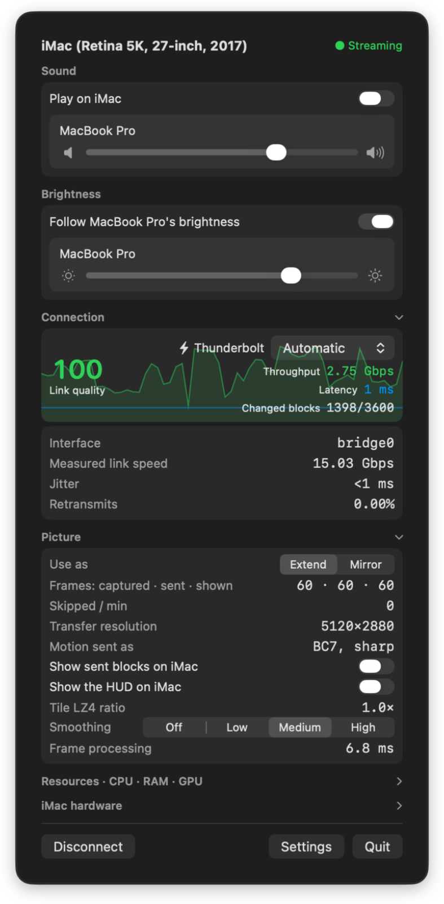
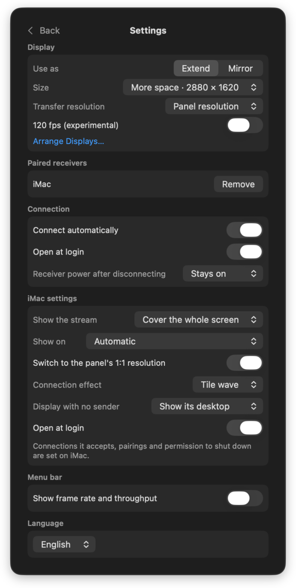

# Afterscreen

[English](README.md)

iMac을 Apple Silicon Mac의 디스플레이로 씁니다. 확장이나 복제로 쓸 수 있고, iMac 본래 해상도로 최대 5120 × 2880, 60fps까지 표시합니다.

2014년 말 이후 iMac에는 대상 디스플레이 모드가 없습니다. Afterscreen은 이런 iMac과 그 이전 iMac을 다시 모니터로 쓸 수 있게 합니다. 두 Mac에 메뉴 막대 앱을 하나씩 설치하고 케이블이나 Wi-Fi로 연결하면 됩니다. 캡처 카드, 드라이버, 외부 라이브러리는 필요 없습니다.

https://github.com/user-attachments/assets/3697271a-2277-4654-8ac2-8207e01cdc76

## 장점

- **원래 해상도 그대로, 선명한 글자.** 빠른 케이블에서는 화면을 영상으로 압축하지 않습니다. GPU 텍스처 블록으로 보내고, iMac의 GPU가 바로 그립니다. 영상 디코더를 거치지 않으니 코덱 지연도 없습니다.
- **어떤 연결이든.** Thunderbolt, USB-C 케이블, 이더넷, Wi-Fi 모두 됩니다. 느린 연결에서는 움직이는 부분만 영상으로 보내고, 멈춰 있는 부분은 원래 해상도를 유지합니다.
- **가장 빠른 링크로, 끊김 없이.** 가장 빠른 링크를 자동으로 고릅니다.
  - 연결 중에 케이블을 꽂으면 다시 연결하지 않고 프레임 사이에 그 링크로 옮겨 갑니다.
  - 링크가 끊기면 다른 링크로 세션을 이어 가고, 창 배치도 그대로 유지됩니다.
- **오래된 Mac도 수신기로.** 수신기는 macOS 10.15 Catalina 이상의 Intel Mac이나 Apple Silicon Mac에서 돌아갑니다. iMac뿐 아니라 MacBook, 모니터를 연결한 Mac mini나 Mac Pro도 수신기가 될 수 있습니다.
- **한 대의 디스플레이처럼.**
  - Mac의 소리가 Mac의 음량 그대로 iMac 스피커에서 나옵니다.
  - iMac 밝기가 Mac 내장 화면의 밝기를 따라갑니다. 니트 단위로 맞춥니다.

## 주요 기능

- **화면:** 확장 또는 복제. 크기는 큰 글자부터 가장 넓게까지 네 단계입니다. MacBook이 수신기면 카메라 노치 아래를 꽉 채워 표시합니다.
- **화질:**
  - 계단 완화: 8비트 그라데이션의 계단 현상을 줄입니다.
  - 10비트 출력. 스트림이 패널보다 작으면 바이큐빅으로 확대합니다.
  - 측정한 링크 속도에 맞춰 전송 해상도와 영상 비트레이트를 정합니다.
- **연결:**
  - 마지막으로 연결한 수신기에 자동으로 연결합니다. 잠자기에서 깨어난 뒤에도 연결합니다.
  - 이더넷과 Wi-Fi에서는 6자리 코드로 페어링한 Mac만 받습니다. Thunderbolt·USB 케이블은 페어링 없이 연결됩니다.
- **전원:**
  - 연결하고 끊을 때 타일 효과가 나옵니다. 화면 전체 덮기 모드에서는 iMac 데스크톱 위로 스트림이 열리고, 끊으면 다시 데스크톱으로 닫힙니다.
  - 연결을 끊을 때 송신기에서 수신기를 잠자기로 전환하거나 종료할 수 있습니다.
  - 전원에 연결된 MacBook은 덮개를 닫아도 계속 송출합니다.
- **송신기에서 수신기 설정:**
  - 연결된 동안 송신기 메뉴에서 iMac의 스트림 표시 방식과 표시할 화면, 연결 효과, 송신기가 없을 때 화면을 바꿀 수 있습니다. iMac의 HUD도 켜고 끌 수 있습니다.
  - 받을 연결, 페어링, 시스템 종료 허용은 iMac에서만 설정합니다.
- **도구:**
  - 품질 테스트: 지금 링크가 감당하는 해상도와 프레임레이트를 측정합니다.
  - 실시간 메뉴: 링크, 전송량, 지연 시간, 프레임레이트, 두 Mac의 자원 사용량을 보여 줍니다.
- **언어:** 한국어, 영어. iMac은 송신기에서 고른 언어를 따르고, 기본값은 시스템 언어입니다.

<p align="center">
  
  
</p>

## 성능

2017년형 27인치 5K iMac(iMac18,3)이 M5 Pro MacBook Pro에서 받은 실측값입니다.

| 링크 | 전체 화면이 움직일 때 |
|---|---|
| Thunderbolt Bridge | 5K 60fps |
| USB-C 케이블 (USB 네트워킹) | 5K 60fps |
| 기가비트 이더넷 직결 | 5K 60fps, 움직임은 4K HEVC 영상 |
| Wi-Fi | 네트워크에 따라 15–60fps |

## 요구 사항

**송신기:** macOS 14 Sonoma 이상의 Apple Silicon Mac. iMac에서 소리를 내려면 macOS 14.2 이상이 필요합니다. 화면 기록, 로컬 네트워크 권한을 요청하고, 소리를 쓰면 시스템 오디오 녹음 권한도 요청합니다.

**수신기:** macOS 10.15 Catalina 이상의 모든 Mac. 모두 Wi-Fi로 연결할 수 있습니다. 케이블 연결은 다음과 같습니다.

| 수신기 | 케이블 연결 |
|---|---|
| iMac 2017–2020, iMac Pro | Thunderbolt 3, USB-C, 이더넷 |
| iMac 2012–2015 | Apple Thunderbolt 3–Thunderbolt 2 어댑터를 통한 Thunderbolt 1·2, 이더넷 |
| Apple Silicon iMac | Thunderbolt, USB-C, 이더넷(있는 모델) |
| MacBook, Mac mini, Mac Pro | Thunderbolt 또는 USB-C(Thunderbolt 1·2는 어댑터 사용), 이더넷 |

2017년형 27인치 5K iMac에서 네 가지 연결을 모두 시험했습니다. 다른 모델은 요구 사항은 맞지만 아직 시험하지 않았습니다.

## 시작하기

1. [Releases](https://github.com/lakystars/afterscreen/releases)에서 `Afterscreen-<버전>.zip`(송신기)과 `Afterscreen-Receiver-<버전>.zip`(수신기)을 내려받습니다.
2. 압축을 풉니다. **Afterscreen**은 Apple Silicon Mac의, **Afterscreen Receiver**는 iMac의 응용 프로그램 폴더로 옮깁니다.
3. 두 Mac을 Thunderbolt, USB-C, 이더넷 케이블로 연결하거나 같은 Wi-Fi에 둡니다.
4. iMac에서 **Afterscreen Receiver**를 열고, 로컬 네트워크 접근을 물으면 허용합니다.
5. Apple Silicon Mac에서 **Afterscreen**을 열고 로컬 네트워크 접근과 화면 기록을 허용합니다.
6. 메뉴 막대의 Afterscreen 아이콘을 누르고 iMac 옆의 **연결**을 고릅니다.

iMac에서 Esc를 두 번 누르면 세션이 멈추고, ⌥⌘I를 누르면 상태 표시가 나옵니다.

### 처음 열 때

릴리스 빌드는 Apple의 공증을 받지 않아서, 처음 열 때 macOS가 경고합니다.

- **macOS 15 이상:** 앱을 한 번 연 뒤 시스템 설정 → 개인정보 보호 및 보안에서 **그래도 열기**를 누릅니다.
- **macOS 14 이하:** Control 키를 누른 채 앱을 클릭하고 **열기**를 고른 뒤, 한 번 더 **열기**를 누릅니다.

ad hoc 서명 빌드라서 새 버전을 설치할 때마다 화면 기록과 로컬 네트워크 권한을 다시 요청합니다.

직접 빌드하려면 [빌드](#빌드) 항목을 참고하세요.

## 빌드

Apple Silicon Mac에 Xcode가 필요합니다.

```sh
zsh scripts/build_apps.sh
```

`build/Afterscreen.app`(송신기)과 `build/Afterscreen Receiver.app`(수신기, 유니버설)이 만들어집니다.

`AFTERSCREEN_SIGN_IDENTITY`를 지정하면 그 인증서로 서명하고, 없으면 Apple Development 인증서로 서명합니다. 둘 다 없으면 임시(ad hoc) 서명을 하는데, 이때는 빌드할 때마다 macOS가 권한을 다시 묻습니다.

테스트:

```sh
swift test --package-path Core
swift test --package-path Sender
swift test --package-path Receiver
```

## 한계

- iMac의 키보드와 마우스 입력은 Mac으로 전달되지 않습니다.
- Wi-Fi 품질은 네트워크에 따라 다릅니다. 지연이 튀면 화면이 잠깐 멈추는데, 케이블로 연결하면 이런 일이 없습니다.
- 가상 디스플레이에서 Chrome 전체 화면 영상은 약 45–60fps로 재생됩니다. Safari는 60fps를 유지합니다.

## 라이선스

MIT. [LICENSE](LICENSE)를 참고하세요.

iMac, Mac, macOS는 Apple Inc.의 상표이고, Thunderbolt는 Intel Corporation의 상표입니다. Afterscreen은 Apple과 제휴 관계가 없으며 Apple의 보증을 받지 않았습니다.

데모 영상에는 Big Buck Bunny © 2008 Blender Foundation, [CC BY 3.0](https://creativecommons.org/licenses/by/3.0/)이 나옵니다.
